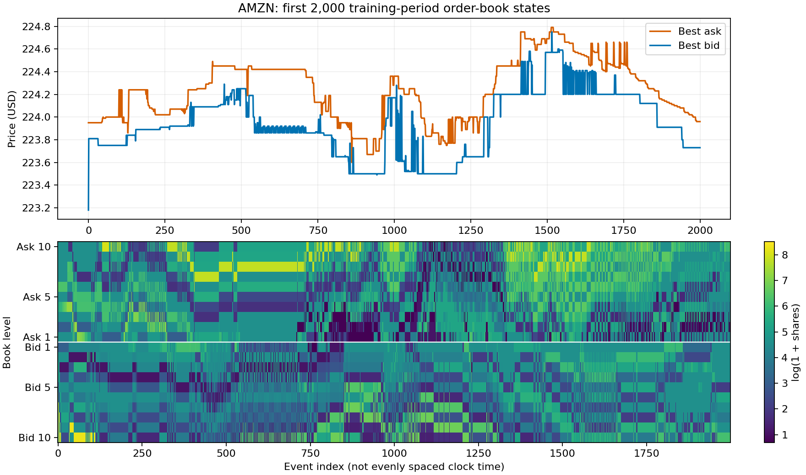

# TimeGAN for AMZN Limit Order Book Simulation

<!-- Add your name and student ID here. -->

## Feasibility review

<!-- Keep the completed review to one page when exported. Suggested length: about 450-550 words. -->

### 1. User need, scope and acceptance criteria

<!-- Write who needs the prototype, the research question and scope, and 3-5 testable acceptance criteria. Include a resource limit. -->

### 2. Model choice and course concepts

<!-- Explain the proposed TimeGAN model, Hard difficulty, simpler baseline, dataset configuration, and relevant course concepts/literature. -->

### 3. Preliminary feasibility evidence

<!-- Use the measured data-audit and GPU batch-check evidence in reports/data_audit.json. Full model training has not yet been tested. -->

### 4. Risks, budget and fallback

<!-- Cover technical risks, available time and hardware, the next experiment, and a workable fallback. -->

## Project overview and research question

<!-- Expand the project's purpose and research question for the final report. -->

## How the model works

<!-- Explain TimeGAN and the baseline. Add an architecture figure if useful. -->

## Data and preprocessing

<!-- Describe the dataset, chronological splits, price transformations, volume scaling, and leakage prevention. -->

## Setup and usage

<!-- Add exact dependency versions and commands for training, evaluation and prediction. -->

## Experiments and results

<!-- Compare TimeGAN and the baseline on identical evaluation splits. Report KL divergence, SSIM, book validity, temporal behaviour, and GPU memory/runtime/throughput. -->

## Failure analysis and recommendation

<!-- Include 3-5 real/generated heatmap comparisons, diagnose failures, discuss limitations, and make an evidence-based recommendation. -->

## Artificial intelligence usage disclosure

<!-- Describe all AI assistance and how you verified the work; update this as work progresses. -->

## References

<!-- Add the course brief, TimeGAN paper, dataset source and any other sources used. -->

<!-- To add an image, save it in figures/ and use:

-->
